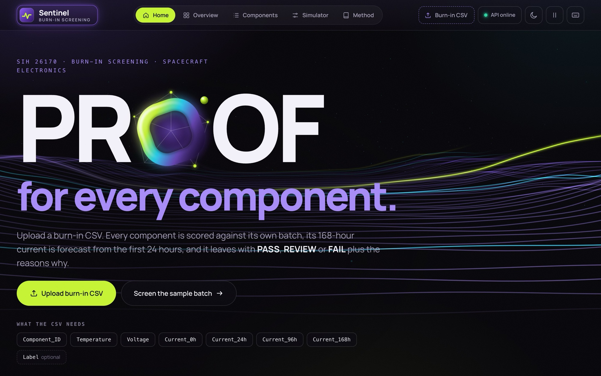
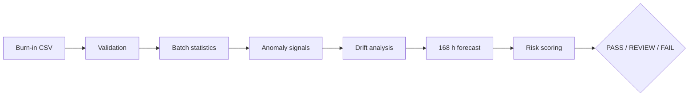
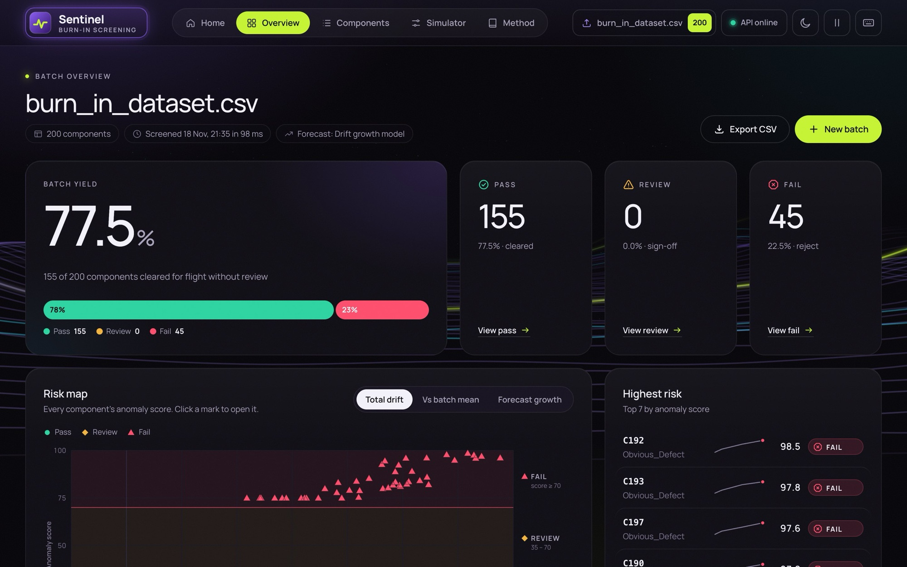
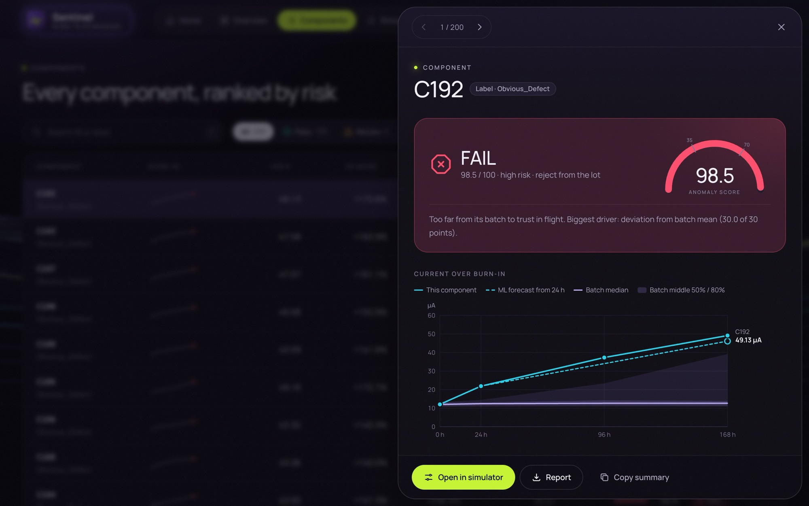
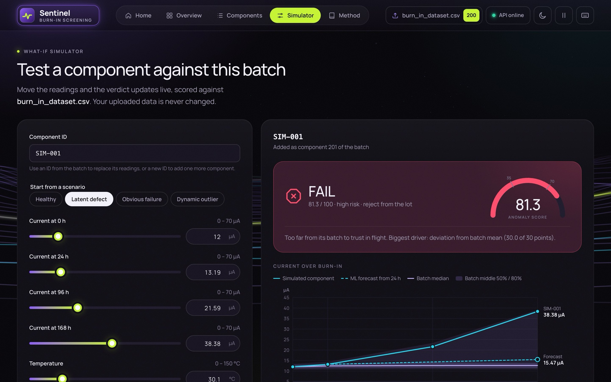
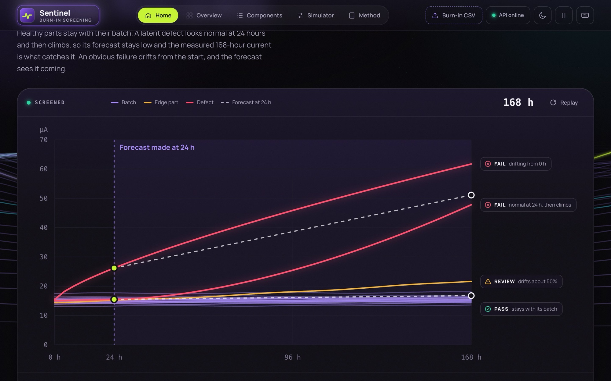
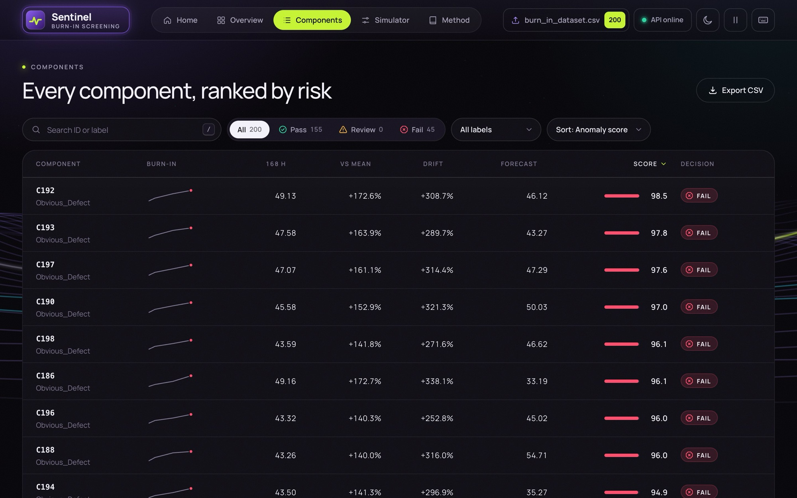
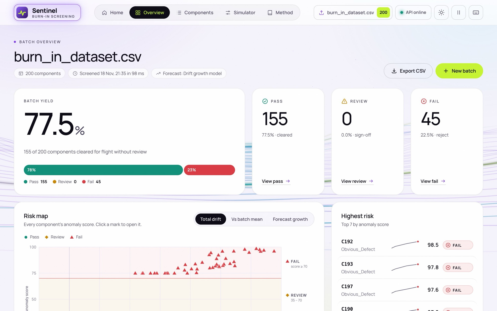
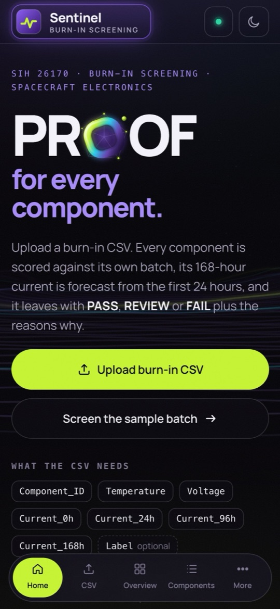
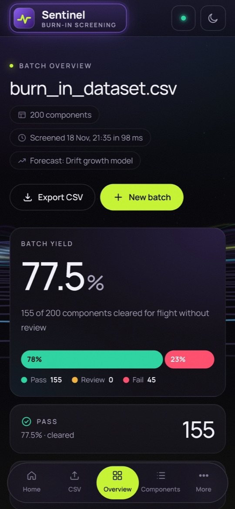

<div align="center">


# Sentinel

### AI-driven burn-in screening for spacecraft electronic components

**Smart India Hackathon · Problem statement 26170**

Upload a burn-in CSV. Every component is scored against its own batch, its 168-hour current is forecast from the first 24 hours, and it leaves with **PASS**, **REVIEW** or **FAIL**, plus the reasons why.

[](https://github.com/adityashukla44/SIH26170-Sentinel/actions/workflows/tests.yml)


[](LICENSE)

[Quick start](#quick-start) · [How it works](#how-it-works) · [Forecast model](#the-168-h-forecast-model) · [Dashboard](#the-dashboard) · [API](#api) · [Architecture](docs/ARCHITECTURE.md)

</div>

<br>



## Why

Burn-in runs every flight component at temperature and voltage for 168 hours so that weak parts fail on the ground, not in orbit. Reading the results is slow and subjective: a part can drift a little and still be fine, while a **latent defect** looks normal at 24 hours and only climbs later.

Sentinel screens a whole batch in about 100 ms. It compares each component with its own batch rather than a fixed limit, forecasts where it will be at 168 hours, and explains every verdict so an engineer can sign it off.

## Highlights

- **Batch-relative scoring.** Five weighted signals (deviation from batch mean and median, z-score, total drift, forecast growth) give a 0 to 100 anomaly score with clear thresholds.
- **168 h forecast from 24 h.** A robust drift growth model predicts late-stage current, with an out-of-range guard and a linear fallback so it never extrapolates silently.
- **Explainable verdicts.** Every component shows its biggest driver, points per signal, score floors and escalations.
- **Checked against ground truth.** If the CSV has a `Label` column, the batch is scored against it: detection rate, false alarms and a confusion matrix.
- **What-if simulator.** Change a component's readings and see the verdict update against the same batch.
- **Fast, dependency-free dashboard.** Vanilla JavaScript, hand-drawn SVG charts and a live WebGL background, served by the API itself. It works offline.

## Results on the sample batch

`data/burn_in_dataset.csv` holds 200 labelled components. Screening it gives **155 PASS, 0 REVIEW, 45 FAIL (77.5% yield)**:

| Label | Components | PASS | FAIL |
|---|---:|---:|---:|
| Healthy | 120 | **120** | 0 |
| Edge noise | 40 | 35 | 5 |
| Latent defect | 25 | 0 | **25** |
| Obvious defect | 15 | 0 | **15** |

**All 40 defects caught, none of the 120 healthy parts flagged.** The forecast model was trained on this batch; its cross-validated figures, where every component is forecast by a model that never saw it, are in [the model section](#the-168-h-forecast-model) and give the same 40 of 40 and 0 of 120.

## Quick start

Requires Python 3.12 or newer.

```bash
git clone https://github.com/adityashukla44/SIH26170-Sentinel.git
cd SIH26170-Sentinel
python3 -m venv .venv
source .venv/bin/activate          # Windows: .venv\Scripts\activate
pip install -r requirements.txt
uvicorn app.main:app --reload
```

Open **http://localhost:8000** and click **Screen the sample batch**, or drop your own CSV on the **Burn-in CSV** page. Interactive API docs are at http://localhost:8000/docs.

### CSV format

One row per component. Currents are in µA, temperature in °C, voltage in V.

| Column | Type | Notes |
|---|---|---|
| `Component_ID` | text | Unique |
| `Temperature` | number | °C |
| `Voltage` | number | V |
| `Current_0h`, `Current_24h`, `Current_96h`, `Current_168h` | number | µA |
| `Label` | text | Optional ground truth, never used for scoring |

Files are checked in the browser before upload and again on the server: missing columns, non-numeric or blank values and duplicate IDs are rejected with a clear message. The limit is 10 MB.

## How it works



### Scoring

Each signal is scaled to 0 to 1 (capped at its full-marks point), weighted, and summed into a 0 to 100 anomaly score.

| Signal | Weight | Full marks at |
|---|---:|---:|
| Deviation of the 168 h current from the batch mean | 30% | 100% |
| Deviation from the batch median | 20% | 150% |
| Statistical outlier (z-score) | 15% | 3σ |
| Total drift over burn-in (0 h to 168 h) | 20% | 100% |
| Forecast growth after 24 h | 15% | 100% |

| Score | Verdict |
|---|---|
| below 35 | **PASS** |
| 35 up to 70 | **REVIEW** |
| 70 and above | **FAIL** |

**Strong-evidence floors** lift the score when one fact is decisive: 168 h current at least 100% from the batch mean (floor 80) or 200% (floor 90), current at least doubled during burn-in (75), forecast 168 h current at least double the 24 h reading (75).

**Forecast escalation:** forecast growth of 100% or more after 24 h is always FAIL, and 50% or more turns a PASS into REVIEW.

## The 168 h forecast model

`models/drift_model.pkl` is a **drift growth model** ([`app/drift_model.py`](app/drift_model.py)). It predicts how much a component's current will grow from 24 h to 168 h from how much it drifted in the first 24 hours:

```
168 h = 24 h × (1.044 + 1.302 × early drift)        early drift = (24 h − 0 h) ÷ 0 h
```

It is a robust Huber regression. Because it works in ratios rather than absolute microamps, it carries over to batches that run at a different current level, and a part that doesn't drift is forecast not to grow.

Five-fold cross-validation on the 200 components, screened with the real rules:

| Model | MAE | Median error | Defects caught | Healthy flagged |
|---|---:|---:|---:|---:|
| **Drift growth model (Huber), shipped** | 4.77 µA | 1.28 µA | 40 / 40 | **0 / 120** |
| Growth model, monotonic HistGB | 3.91 µA | 0.64 µA | 40 / 40 | 4 / 120 |
| GradientBoosting on raw currents | 3.93 µA | 0.75 µA | 40 / 40 | 1 / 120 |
| RandomForest on raw currents | 4.60 µA | 1.36 µA | 40 / 40 | 11 / 120 |
| Previous model (RandomForest, ~10 µA data) | 14.3 µA | – | 40 / 40 | 118 / 120 |

The mean error comes from latent defects, which look healthy at 24 h by definition (cross-validated MAE: healthy parts 0.91 µA, latent defects 18.5 µA). The measured 168 h current still catches them; the forecast's job is to avoid false alarms on healthy parts. The raw-current models score a lower MAE but forecast a flat 15 µA part to reach 35 µA, so they don't transfer to other batches.

**Out-of-range guard.** The forecast is used only when the input is inside the range the model was trained on (early drift between −64% and +146%). Anything else uses a linear fallback and is reported as `FALLBACK_OUT_OF_RANGE`.

**Forecast check.** Every screening compares the forecasts with the measured 168 h currents (mean and median error, share within ±10%, components outside the trusted range) and warns when the model looks unreliable for that batch.

Retrain after changing the data. This writes the `.pkl` and a `.json` with the formula, metrics, trusted range and training fingerprints:

```bash
python -m app.train_drift_model --compare
```

## The dashboard

| | |
|---|---|
|  |  |
| **Overview.** Yield, verdict counts, risk map and highest-risk parts. | **Component detail.** Verdict, score gauge, current against the batch band and the forecast. |
|  |  |
| **Simulator.** Move the readings and the verdict updates live. | **Burn-in monitor.** An illustrated run showing why each part gets its verdict. |
|  |  |
| **Components.** Sortable, searchable and filterable, with sparklines; exports to CSV. | **Light theme.** Every view in dark and light. |

<p align="center">
  
  &nbsp;&nbsp;
  
</p>

| View | What it shows |
|---|---|
| **Home** | The landing page and an animated burn-in monitor: healthy band, an edge part, a latent defect and an obvious failure, with the model's 24 h forecasts. |
| **Burn-in CSV** | Drag-and-drop upload with in-browser checks and an animated screening pipeline. |
| **Overview** | Yield, verdict counts, risk map, highest-risk components, batch current over burn-in, statistics, the ground-truth check and the forecast check. |
| **Components** | Every component in a sortable, searchable, filterable table. Export the current view as CSV. |
| **Detail panel** | Verdict, score gauge, the five signals with points, floors and escalations, stage drift and every reading. Download a JSON report or copy a summary. |
| **Simulator** | What-if scoring against the loaded batch, starting from Healthy, Latent defect, Obvious failure or Dynamic outlier. |
| **Method** | Pipeline, weights, thresholds, forecast rules and API, for reviewers. |

**Live 3D background.** Every page sits on a WebGL field of burn-in traces rolling toward you: most rows stay flat, a few drift (cyan) and a few climb late like latent defects (lime). It speeds up while a batch is screened, ripples when the result arrives, and calms down on data pages. Pause it from the header, with `M`, or from More on phones. It shows a still frame when the system asks for reduced motion and falls back to a plain background without WebGL.

**Keyboard shortcuts**

| Key | Action |
|---|---|
| `1` – `5` | Home, Overview, Components, Simulator, Method |
| `N` | Upload a new batch |
| `/` | Search components |
| `←` `→` | Previous or next component in the detail panel |
| `Esc` | Close the panel or menu |
| `T` | Light or dark theme |
| `M` | Pause or play the 3D background |
| `?` | List shortcuts |

Opening `frontend/index.html` from disk or hosting it elsewhere? Add `?api=http://127.0.0.1:8000` once and it is remembered.

## API

| Method | Path | Description |
|---|---|---|
| `GET` | `/health` | Status, version and forecast model info |
| `POST` | `/batch/screen` | CSV upload → every component screened; the batch is kept for the simulator |
| `POST` | `/batch/{batch_id}/simulate` | JSON component → screened against a stored batch |
| `POST` | `/batch/analyze-component` | CSV + `component_id` → one component against its batch |
| `POST` | `/batch/analyze` | CSV → batch statistics |
| `POST` | `/analyze` | JSON component → quick single check |
| `GET` | `/sample/burn_in_dataset.csv` | The bundled sample dataset |

```bash
curl -F "file=@data/burn_in_dataset.csv" http://localhost:8000/batch/screen
```

```jsonc
{
  "status": "success",
  "batch_id": "…",
  "summary": {
    "component_count": 200,
    "decision_counts": { "PASS": 155, "REVIEW": 0, "FAIL": 45 },
    "yield_percent": 77.5,
    "prediction_sources": { "ML_MODEL": 200 }
  },
  "results": [
    {
      "component_id": "C192",
      "decision": "FAIL",
      "anomaly_score": 98.53,
      "predicted_168h": 46.12,
      "prediction_source": "ML_MODEL",
      "reasons": ["168h current is significantly different from the batch average", "…"],
      "score_breakdown": { "…": "points per signal, floors, escalation" }
    }
  ],
  "evaluation": { "detection_rate": 100.0, "false_alarm_rate": 0.0 },
  "forecast_check": { "…": "…" }
}
```

## Tests

```bash
python -m pytest
```

The suite covers the health and model endpoints, whole-batch screening, consistency between batch and single-component scoring, the simulator, upload validation and the served dashboard. It runs on every push and pull request through [GitHub Actions](.github/workflows/tests.yml).

## Project structure

```
app/
  main.py               FastAPI endpoints, batch store, serves the dashboard
  batch_analysis.py     Validation, per-component scoring, batch screening, checks
  prediction_engine.py  168 h forecast, range guard, fallback, model info
  drift_model.py        Drift growth model (pickled into models/drift_model.pkl)
  train_drift_model.py  Training: cross-validation, comparison, model + metadata
  analysis_engine.py    Rules for the quick /analyze endpoint
  schemas.py            Request and response models
frontend/
  index.html            Markup and icon sprite
  css/                  Design tokens, layout, components, light and dark themes
  js/app.js             Views, routing, simulator, export, shortcuts
  js/backdrop3d.js      Live 3D background (plain WebGL)
  js/home.js            Animated burn-in monitor
  js/charts.js          Hand-drawn SVG charts
  js/csv.js             In-browser CSV checks that mirror the backend
  fonts/                Manrope (SIL Open Font License)
data/                   Burn-in datasets
models/                 drift_model.pkl and its metadata
docs/                   Architecture, integration checklist, screenshots
tests/                  API tests
```

## Team

Built for Smart India Hackathon problem statement 26170.

| Member | Role |
|---|---|
| Aditya Shukla | Backend, screening engine and dashboard |
| Shruti | Burn-in dataset |
| Kunal | Drift model |
| Chaitanya | Frontend integration |

## License

[MIT](LICENSE). The Manrope font is under the [SIL Open Font License](frontend/fonts/OFL-manrope.txt).
