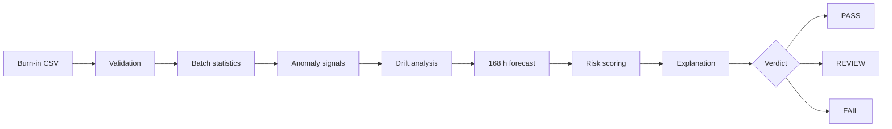
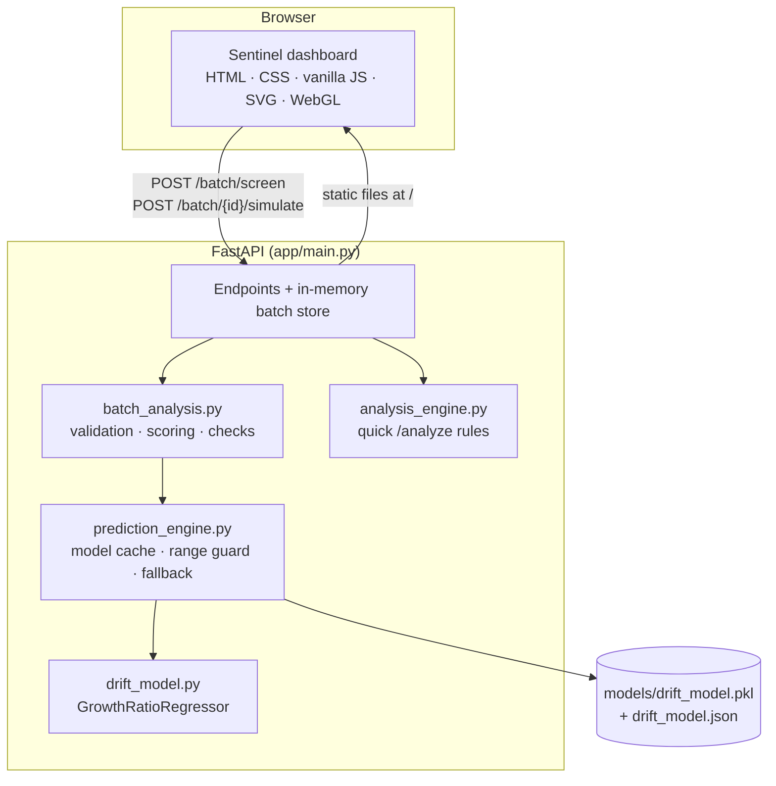

# Architecture

Sentinel is one FastAPI service. It scores burn-in data and also serves the dashboard, so there is a single process to run.

## Screening pipeline

1. **Validation**: required columns, numeric values, no blanks, unique `Component_ID`.
2. **Batch statistics**: mean, median, spread and percentile bands of each reading across the batch.
3. **Anomaly signals**: how far each component's 168 h current sits from the batch mean and median, and its z-score.
4. **Drift analysis**: how much the current grew between 0 h and 168 h.
5. **168 h forecast**: the drift growth model predicts the 168 h current from the 0 h and 24 h readings.
6. **Risk scoring**: five weighted signals form a 0 to 100 anomaly score, with floors for strong evidence and an escalation for forecast growth.
7. **Explanation**: the biggest driver, every signal's points and any floor or escalation that applied.

## Components

| Module | Responsibility |
|---|---|
| `app/main.py` | Endpoints, upload checks (type, size, parse errors), in-memory store of the last 16 batches, serves `frontend/` at `/` |
| `app/schemas.py` | Pydantic request and response models |
| `app/batch_analysis.py` | Dataset validation, per-component scoring, whole-batch screening, label and forecast checks |
| `app/prediction_engine.py` | Loads the model once, vectorised batch forecasts, out-of-range guard, linear fallback, model info for `/health` |
| `app/drift_model.py` | `GrowthRatioRegressor`: 168 h = 24 h × (a + b × early drift), fitted with a Huber regression |
| `app/train_drift_model.py` | Trains and cross-validates the model, compares alternatives, writes the `.pkl` and `.json` |
| `app/analysis_engine.py` | Anomaly and drift rules for the single-component `/analyze` endpoint |
| `frontend/` | The Sentinel dashboard: no build step and no libraries |

## Main endpoints

| Method | Path | Purpose |
|---|---|---|
| `POST` | `/batch/screen` | Every component in one call (used by the dashboard) |
| `POST` | `/batch/{batch_id}/simulate` | What-if component scored against a stored batch |
| `POST` | `/batch/analyze-component` | One component against its batch |

The full list is in the [README](../README.md#api).
